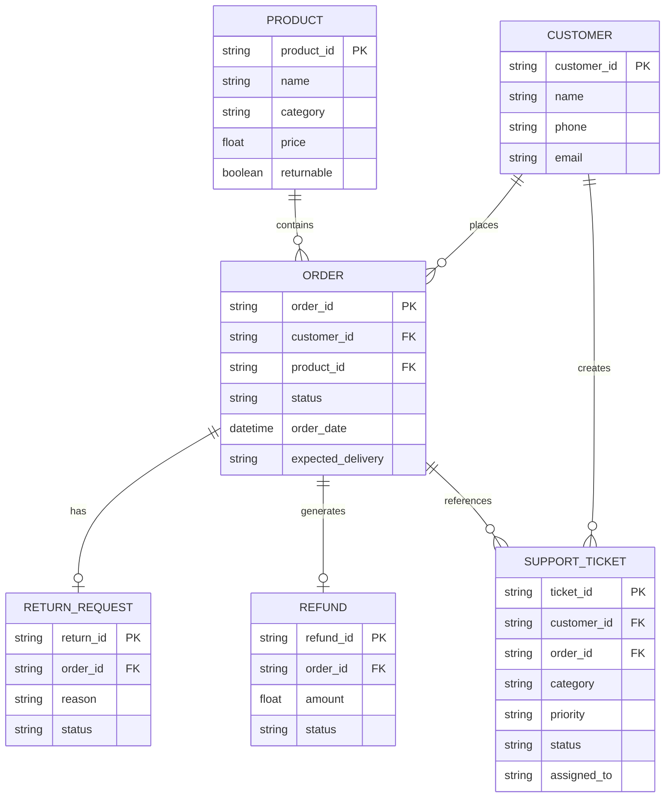
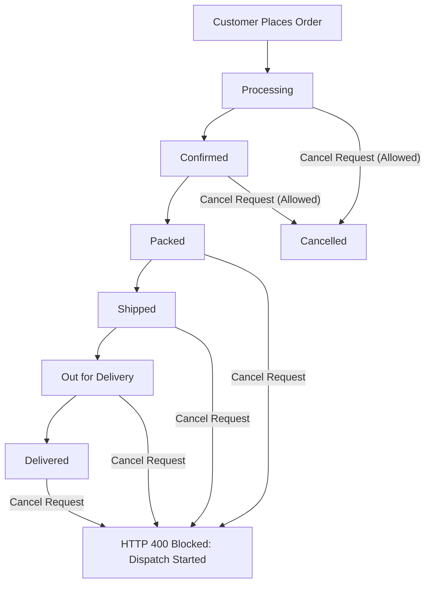
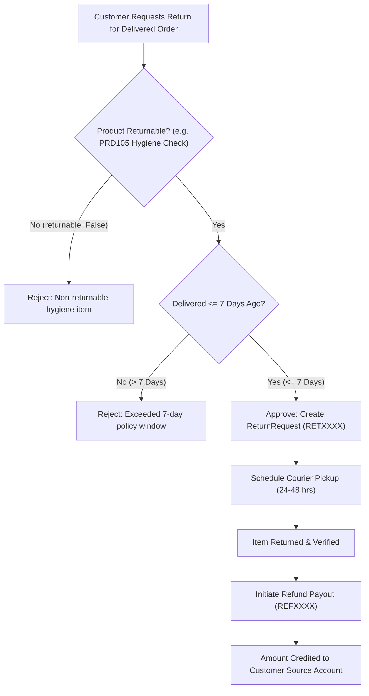
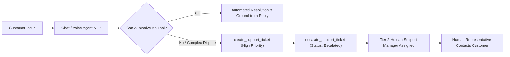

# ShopSathi AI — System Architecture & Design Document

**B.Tech CSE Minor Project — MBM University, Jodhpur**  
Mahendra Gurjar (24UCSE4018) · Kailash (24UCSE4014)

---

## 1. System Overview

ShopSathi AI is a full-stack AI-powered e-commerce and customer support platform. It integrates a Vanilla JavaScript Single Page Application frontend, a FastAPI Python backend, a SQLite database via SQLAlchemy ORM, and browser-based AI Chat and Voice assistants — all in one cohesive system.

```
                  +--------------------------------------+
                  |      Customer Browser (SPA)          |
                  |   11 Pages + AI Chat + Voice UI      |
                  +------------------+-------------------+
                                     |
                                     | HTTP + X-Customer-ID
                                     |
                  +------------------v-------------------+
                  |    ShopSathi FastAPI Backend         |
                  |  Products | Orders | Returns         |
                  |  Refunds  | Support | Analytics      |
                  |  Security | Logging | Health         |
                  +------------------+-------------------+
                                     |
                                     | SQLAlchemy ORM
                                     |
                  +------------------v-------------------+
                  |    SQLite Database (shopsathi.db)    |
                  |  7 Tables: customers, products,      |
                  |  orders, returns, refunds,           |
                  |  support_tickets, audit_logs         |
                  +--------------------------------------+
```

---

## 2. AI Assistant Architecture

The Chat Agent and Voice Assistant are built entirely within the browser and ShopSathi backend:

```
User Input (Text or Voice)
         |
         v
processAgentQuery()     ← JavaScript NLP (AiLauncher.js)
         |
   Pattern Matching
   (intent + params)
         |
         v
Backend REST API Call   ← fetch() with X-Customer-ID header
  GET /orders/{id}
  POST /returns
  GET /products/search
  POST /support/tickets
         |
         v
JSON Response           ← FastAPI + SQLAlchemy
         |
         v
Formatted Reply (Chat)  ← Markdown to HTML
     OR
Spoken Reply (Voice)    ← SpeechSynthesis API
```

---

## 3. Intent-to-Function Mapping

| User Intent | AI Tool Called | REST Endpoint | Method | Output |
|---|---|---|---|---|
| Order Tracking | `check_order_status` | `/orders/{order_id}` | GET | Status, delivery date |
| Return Eligibility | `check_return_eligibility` | `/orders/{id}/return-eligibility` | GET | Eligible boolean |
| Request Return | `create_return_request` | `/returns` | POST | Return ID |
| Refund Status | `check_refund_status` | `/orders/{id}/refund` | GET | Refund ID, payout date |
| Product Search | `search_products` | `/products/search` | GET | Matching products |
| Cancel Order | `cancel_order` | `/orders/{id}/cancel` | POST | Cancelled status |
| Create Ticket | `create_support_ticket` | `/support/tickets` | POST | Ticket ID |
| Human Escalation | `escalate_support_ticket` | `/support/tickets/{id}/escalate` | POST | Escalated status |

---

## 4. Database Entity Relationships



---

## 5. Security Architecture

| Layer | Mechanism | Enforcement |
|---|---|---|
| Authentication | `X-Customer-ID` HTTP header | Required on all private endpoints |
| Authorization | `require_current_customer` FastAPI dependency | 401 if missing, 403 if cross-account |
| Guest Blocking | `CUST105`/`GUEST` identity check | Treated as unauthenticated |
| API Key | `X-API-Key` header + env var | Optional; enforced if `SHOP_SATHI_API_KEY` is set |
| Error masking | Global exception handler | 500 response with no stack trace |
| SQL Injection | SQLAlchemy ORM parameterized queries | Automatic |
| Secrets | All keys in `.env` only | Never in frontend code or git commits |

---

## 6. Order Management & Cancellation Workflow



---

## 7. Return & Refund Evaluation Workflow



---

## 8. AI-to-Human Support Escalation Pipeline



