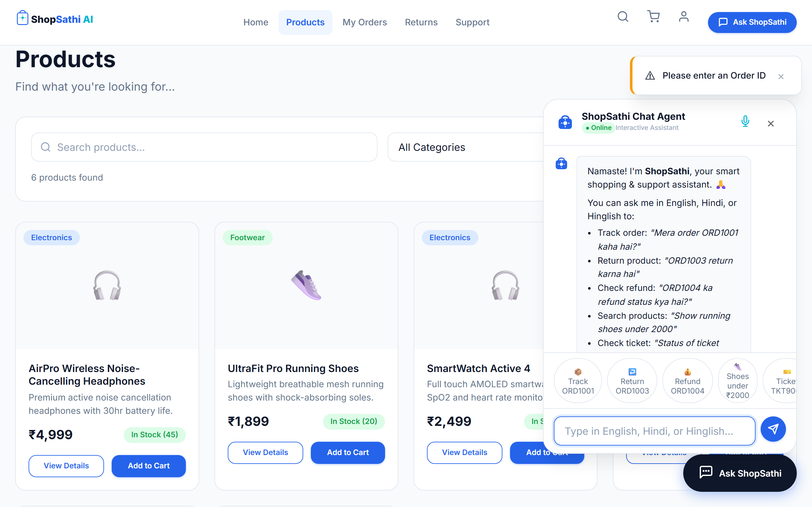

# Chat Agent Documentation

## 🤖 Model & Capabilities

The ShopSathi Chat Agent provides low-latency, deterministic tool execution in e-commerce customer workflows using browser-side intent matching with backend REST API tool-calling.

---

## 🌐 Multilingual Processing

The Chat Agent natively understands and responds in **English, Hindi, and Hinglish**:

### User Query Examples
* **English**: *"Where is my order ORD1001?"*
  ➔ *Invokes `check_order_status(order_id='ORD1001')`* ➔ Responds with status "Out for Delivery" and expected delivery time.
* **Hindi**: *"मेरा आर्डर ORD1001 कहाँ है?"*
  ➔ *Invokes `check_order_status(order_id='ORD1001')`* ➔ Responds in fluent Hindi.
* **Hinglish**: *"Mera order ORD1001 kab deliver hoga?"*
  ➔ *Invokes `check_order_status(order_id='ORD1001')`* ➔ Responds: *"Aapka order ORD1001 'Out for Delivery' hai aur aaj shaam 7:00 PM tak deliver ho jayega."*

---

## 🛡️ Deterministic Execution & Ground-Truth Verification

1. **Live API Grounding**: Responses are derived directly from live database state (via backend REST API endpoints) rather than speculative generative text.
2. **Context Persistence**: Maintains extracted parameters (e.g. order IDs) across multi-turn interactions.
3. **Escalation Trigger**: When unresolved disputes or friction occurs (e.g., duplicate deductions, payment failures), the agent automatically creates a support ticket with priority *Critical* and routes to Tier-2 human support.

---

## ⚡ Latency & Performance Profile

* **Intent Detection Execution**: `0.001 – 0.040 ms` (V8 precompiled regex engine)
* **Local Intent Generation (Greetings, Policies)**: `0.05 – 0.35 ms`
* **Real Backend API Roundtrip**: `14 – 35 ms` (FastAPI + SQLite)
* **Catalog Cache Hit**: `0.002 ms` (60s TTL)
