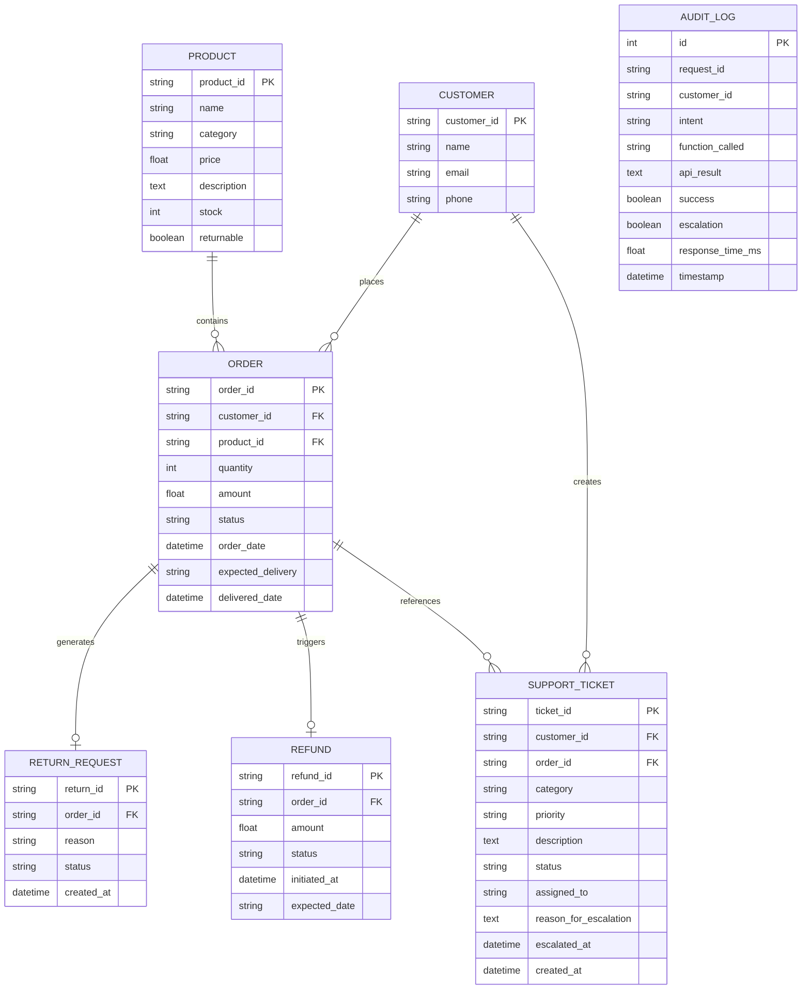

# Database Schema & Data Models

ShopSathi AI utilizes **SQLAlchemy ORM** to manage relational models with automated seed data generation and strict customer ownership foreign keys.

---

## 🗄️ Entity Relationship Diagram (ERD)

---

## 📋 Entity Descriptions

1. **`Product` (`products`)**: Stores catalog items with category and return eligibility.
   - `product_id` (PK, string, indexed)
   - `name` (string, indexed)
   - `category` (string, indexed: Electronics, Footwear, Fashion, Home)
   - `price` (float)
   - `description` (text)
   - `stock` (integer)
   - `returnable` (boolean, default: True)

2. **`Customer` (`customers`)**: Stores authenticated customer profiles.
   - `customer_id` (PK, string, indexed: `CUST101`, `CUST102`, etc.)
   - `name` (string)
   - `email` (string)
   - `phone` (string)

3. **`Order` (`orders`)**: Tracks customer orders and fulfillment milestones.
   - `order_id` (PK, string, indexed: `ORD1001` to `ORD1052`)
   - `customer_id` (FK -> `customers.customer_id`)
   - `product_id` (FK -> `products.product_id`)
   - `quantity` (integer)
   - `amount` (float)
   - `status` (string: `Delivered`, `Out for Delivery`, `Processing`, `Cancelled`)
   - `order_date` (datetime)
   - `expected_delivery` (string)
   - `delivered_date` (datetime, nullable)

4. **`ReturnRequest` (`return_requests`)**: Manages customer return submissions.
   - `return_id` (PK, string, indexed)
   - `order_id` (FK -> `orders.order_id`, unique)
   - `reason` (string: Defective, Size Issue, Wrong Item, etc.)
   - `status` (string: `Submitted`, `Approved`, `Rejected`)
   - `created_at` (datetime)

5. **`Refund` (`refunds`)**: Records payout amounts and schedules.
   - `refund_id` (PK, string, indexed)
   - `order_id` (FK -> `orders.order_id`, unique)
   - `amount` (float)
   - `status` (string: `Initiated`, `Processing`, `Completed`, `Failed`)
   - `initiated_at` (datetime)
   - `expected_date` (string)

6. **`SupportTicket` (`support_tickets`)**: Tracks customer disputes and human escalations.
   - `ticket_id` (PK, string, indexed: `TKT9001` to `TKT9006`)
   - `customer_id` (FK -> `customers.customer_id`)
   - `order_id` (FK -> `orders.order_id`, nullable)
   - `category` (string: Payment Issue, Return Dispute, Shipping Delay, etc.)
   - `priority` (string: `Low`, `Medium`, `High`, `Critical`)
   - `description` (text)
   - `status` (string: `Open`, `Escalated`, `In Progress`, `Resolved`)
   - `assigned_to` (string, default: "AI Agent")
   - `reason_for_escalation` (text, nullable)
   - `escalated_at` (datetime, nullable)
   - `created_at` (datetime)

7. **`AuditLog` (`audit_logs`)**: Persists structured observability records for AI actions.
   - `id` (PK, integer, autoincrement)
   - `request_id` (string, indexed)
   - `customer_id` (string, nullable)
   - `intent` (string)
   - `function_called` (string)
   - `api_result` (text)
   - `success` (boolean)
   - `escalation` (boolean)
   - `response_time_ms` (float)
   - `timestamp` (datetime)
