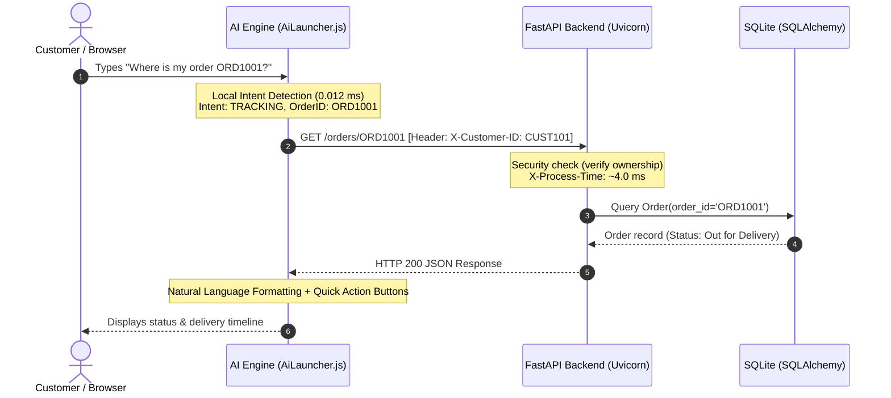
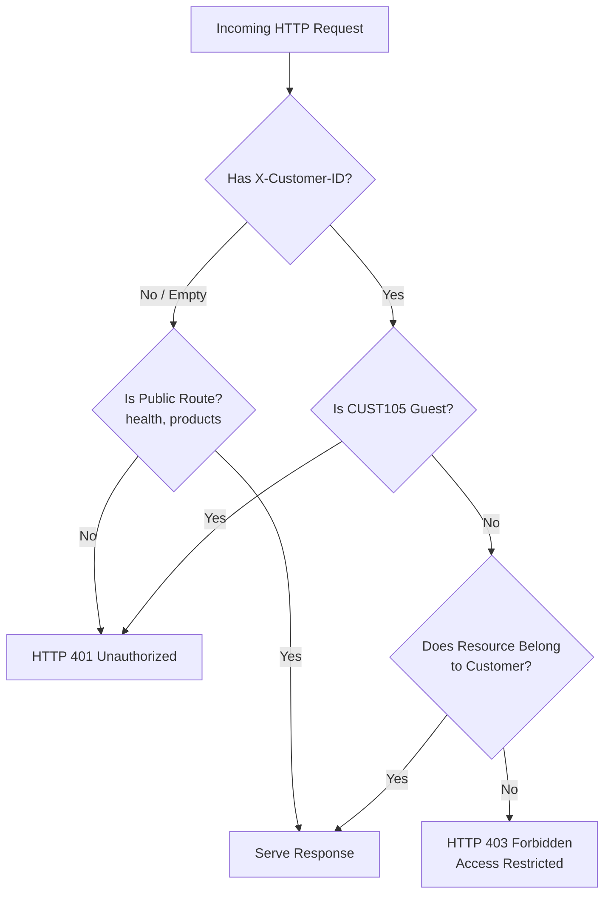

# System Architecture

## 🏛️ Architecture Overview

ShopSathi AI is built on a modular, decoupled 3-tier architecture designed for deterministic execution, high performance, and strict customer privacy:

```
                        CUSTOMER INTERACTION LAYER
               ┌──────────────────────────────────────────┐
               │  Web Browser SPA (11 Views)              │
               │  Chat Agent (Floating Slideout Drawer)   │
               │  Voice Assistant (W3C Web Speech API)    │
               └────────────────────┬─────────────────────┘
                                    │ HTTP Requests
                                    │ X-Customer-ID Header (Auth)
                                    ▼
                    SHOPSATHI FASTAPI BACKEND LAYER
               ┌──────────────────────────────────────────┐
               │  Routers: Products, Orders, Returns,     │
               │           Refunds, Support, Analytics    │
               │  Security: Customer isolation (401/403)  │
               │  Business Rules: 7-day return policy     │
               │  Tier-2 Human Escalation Pipeline        │
               │  Structured Audit Logging                │
               └────────────────────┬─────────────────────┘
                                    │ SQLAlchemy ORM
                                    ▼
                       DATA PERSISTENCE LAYER
               ┌──────────────────────────────────────────┐
               │  SQLite Database (shopsathi.db)          │
               │  7 Relational Tables                     │
               │  Products, Orders, Customers, Returns,   │
               │  Refunds, Support Tickets, Audit Logs    │
               └──────────────────────────────────────────┘
```

---

## 🔄 End-to-End Request-Response Flow



---

## 🧩 Architectural Layers & Responsibilities

### 1. Presentation Layer (Frontend SPA)
* **Framework**: Vite + Vanilla JavaScript ES6 Modules
* **Responsibilities**: Client-side hash routing (`#/`, `#/products`, `#/orders`, etc.), reactive UI components, shopping cart in `localStorage`, floating dual AI launcher (chat + voice), interactive admin monitoring dashboard.

### 2. AI Assistant Layer (Browser-Side)
* **Chat Agent**: Deterministic NLP regex parsing engine (`processAgentQuery()`) coupled with live REST API tool execution.
* **Voice Agent**: Standard W3C `SpeechRecognition` API (speech-to-text) + `SpeechSynthesis` API (text-to-speech) with real-time waveform states.
* **Latency Profile**:
  - In-memory regex intent classification: `0.001 – 0.040 ms`
  - Real backend API roundtrip: `14 – 35 ms`
  - Sentence chunk streaming for TTS: `< 140 ms` Time-To-First-Audio

### 3. Application Layer (FastAPI Backend)
* **Framework**: Python 3.12 + FastAPI + Uvicorn
* **Routers**: 8 modular routers mounted directly and under `/api` alias (`health`, `products`, `orders`, `customers`, `returns`, `refunds`, `support`, `analytics`).
* **Business Validation**: Delivered orders cannot be cancelled; returns restricted to 7-day post-delivery window; non-returnable hygiene items blocked.
* **Observability**: Latency instrumentation middleware (`X-Process-Time` header) and structured audit logging (`AuditLog` table).

### 4. Persistence Layer (Database)
* **ORM**: SQLAlchemy ORM with Pydantic v2 schemas.
* **Database**: SQLite for development, testing, and Render deployment; fully compatible with PostgreSQL.

---

## 🔒 Security & Customer Data Privacy Architecture



* **Authentication**: `X-Customer-ID` header required on all private customer endpoints.
* **Authorization**: `require_current_customer` dependency enforces 403 Forbidden on cross-account access attempts.
* **Data Isolation**: Each customer can only view or modify their own orders, returns, refunds, and support tickets.
* **API Key Guard**: Optional `X-API-Key` header verification via `SHOP_SATHI_API_KEY` environment variable.
