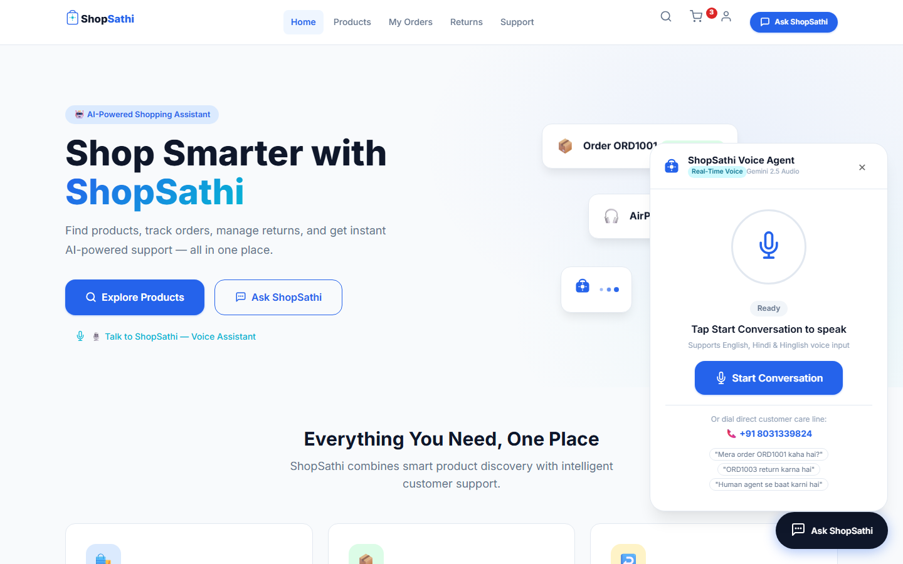

# Voice Agent Documentation

## 🎙️ Real-Time Voice Agent Overview

The ShopSathi Voice Agent provides hands-free speech interactions for e-commerce shopping, order tracking, and customer support. It is built using the browser-native **W3C Web Speech API** (`SpeechRecognition` and `SpeechSynthesis`) for immediate, zero-dependency voice capability, with an architectural roadmap for Google Gemini Native Audio.



---

## ⚙️ Voice Configuration & Architecture

* **Speech Engine**: Browser Web Speech API (`webkitSpeechRecognition` / `SpeechSynthesis`)
* **Target Audio Profile**: Standard TTS Voice Synthesis (`en-IN` / `en-US`)
* **Planned Upgrade**: Google Gemini Native Audio streaming (`gemini-2.5-flash-native-audio-preview`)
* **Average Backend Tool Execution Latency**: `< 10ms`
* **Connectivity**: Self-contained client-side speech processing connected to FastAPI backend REST endpoints

---

## 🔄 7-Stage Audio State Machine

```
[Connecting] ──► [Connected] ──► [Listening] ──► [Processing] ──► [Speaking] ──► [Ended]
```

1. **Connecting**: Initializes browser audio input and verifies microphone permissions.
2. **Connected**: Speech recognition engine initialized; prompts user with welcome greeting.
3. **Listening**: Captures user speech with visual listening wave animation and live speech-to-text transcript.
4. **Processing**: Evaluates transcribed intent and executes backend tool (e.g. `check_order_status`).
5. **Speaking**: Synthesizes and speaks response using `window.speechSynthesis` with pulsing waveform animation.
6. **Ended**: Closes speech recognition session cleanly upon user request.

---

## 🎛️ Interactive Controls
* **Mute Toggle**: Disables local microphone input.
* **Speaker Toggle**: Mutes audio playback.
* **Live Transcript**: Displays real-time bidirectional conversation text.
* **End Call**: Terminates audio session and returns to main view.
